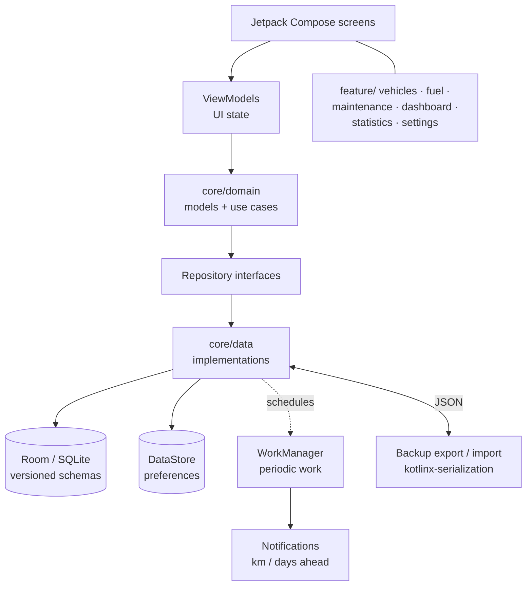
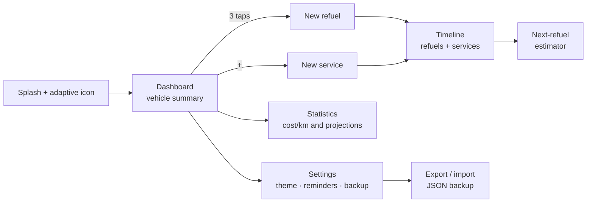

#### 🧠 Project Overview

Goal: answer the questions a vehicle actually gets asked — *how
much have I spent on fuel, what is every kilometer costing me,
when is the next service due, how does my consumption look this
month?* — from the phone, with no account, no connection, and
without anybody else seeing the data.

It started as a tool for personal use: the name ("Vehicle
Manager") is deliberately generic because it was built to solve my
own refuel and workshop log. When a couple of friends liked the
idea, I decided to publish it: an APK downloadable from its own
landing page, a repository on GitHub under the MIT license, and a
public changelog.

Current features:

- **Vehicles:** create and edit brand, license plate and odometer,
  with a list of registered vehicles.
- **Fuel:** record refuels with odometer, price per liter, liters
  and auto-calculated total cost; the new odometer propagates to
  every view of the vehicle.
- **Maintenance:** per-vehicle service history with cost and
  odometer reading, merged with refuels into a single
  **chronological timeline**.
- **Dashboard and statistics:** monthly, quarterly, semi-annual
  and annual summaries, cost per kilometer, monthly breakdown, a
  consumption prediction engine and a next-refuel estimator.
- **Reminders:** alerts ahead by kilometers or days (refuel, tire
  pressure, services) with time and vibration preferences.
- **Settings:** light / dark / automatic theme, JSON backup
  export and import, and a visible state for notification
  permissions.

#### 🏗️ Architecture: Clean Architecture across two packages

The app follows a Clean Architecture with layered separation, in
`com.example.vehiclemanager` split into `core/` (everything
cross-cutting) and `feature/` (one folder per screen with its own
logic).

Each layer lives on its own:

- **UI** — Compose screens with ViewModels exposing UI state; no
  data access straight from composables.
- **Domain** (`core/domain/`) — models, repository interfaces and
  use cases. The only layer the features know about.
- **Data** (`core/data/`) — Room entities and DAOs, the
  `VehicleDatabase` class, DataStore preferences and the
  repository implementations.

#### 🧰 Technologies Used

- **Kotlin** as the only language, with **Jetpack Compose** and
  **Material 3** for declarative UI.
- **Clean Architecture** in `core/` (domain / data / ui) +
  `feature/` (vehicles, fuel, maintenance, settings, dashboard,
  statistics).
- **Room** (local SQLite) as the database, **DataStore** for
  preferences and **Hilt** for dependency injection.
- **WorkManager** for reminders that must survive a device
  reboot, **Coroutines & Flow** as the concurrency model and
  **kotlinx-serialization** for the JSON backup.
- **Tests** with JUnit and Robolectric over the DAOs on the JVM,
  plus instrumented tests on device.
- **Gradle Kotlin DSL** with a version catalog
  (`gradle/libs.versions.toml`) and a public **CHANGELOG.md**
  under SemVer.

🌐 Landing (`vehicle-manager-landing`)

- Download site with the value proposition, four features, a
  privacy section, screenshots (`/screens/*.webp`), an FAQ and
  the APK download block.
- Deployed on **Vercel** at
  <https://vehicle-manager-landing.vercel.app/>, linking the APK
  (≈ 4 MB) directly and the app repository as "View on GitHub".

#### 📦 Infrastructure and Deployment

- **Direct distribution:** release APK downloadable from the
  landing page — no Play Store for now, with "coming soon to
  Google Play" announced on the page itself.
- **Requirements stated to users:** Android 8.0 (API 26) or
  newer, ≈ 4 MB install, current version 0.3.0.
- **Landing on Vercel:** a static site that centralizes the
  pitch, the privacy proof points, the screenshots and the
  download/repository links.
- **Transparency:** public changelog at the root of the
  repository and the MIT license on the code.
- **No backend:** no server, no cloud database, no API keys and
  no third-party services to monitor — the app's "deploy" is a
  single APK file.

#### 🌐 User Navigation and Flows

🧭 Recording flow: open the app → pick the vehicle → fill in
odometer, liters and price → total cost and L/100km calculate
themselves → save → the new odometer updates dashboard,
statistics and timeline in one go.

#### 🔐 Key Technical Decisions

✅ 1. Privacy by design: zero accounts, zero servers

The obvious alternative was a backend with login syncing vehicles
across devices. I dropped it: a person's fuel and expense data is
sensitive, and 90% of the use happens on a single phone. With
local Room/SQLite, no signup and no telemetry, the app behaves
identically on a plane and on wifi, and "what happens to your
data?" gets a one-line answer: *it never leaves your phone*.

✅ 2. `core/` + `feature/` instead of a package per layer

Global layer packages (`ui/`, `domain/`, `data/` at the root)
mean adding a screen touches three different folders and features
leak into each other. The hybrid package keeps each capability
encapsulated — the `fuel/` module does not know `statistics/`
exists — leaving only what is genuinely cross-cutting in `core/`.

✅ 3. WorkManager for reminders, not hand-rolled alarms

The first version scheduled alarms straight with `AlarmManager`,
and they were lost whenever the phone rebooted. Reminders (km or
days ahead) are reschedulable periodic work: WorkManager with
`hilt-work` survives reboots, reschedules automatically, and
surfaces the notification-permission state in Settings instead of
failing silently.

✅ 4. Versioned, exported Room schemas

`app/schemas` holds the JSON of every schema version (five so
far), which turns each migration into a reviewable, testable
artifact under `room-testing` rather than a "trust me" that blows
up on users updating from the Play Store.

✅ 5. Portable JSON backup as the only way to move data

With no cloud and no account, an exportable/importable backup is
the only migration path between phones. A plain JSON file
(`kotlinx-serialization`) over a proprietary binary format keeps
the file readable, versionable and recoverable even if the app
disappears tomorrow.

#### 📈 Current Outcome

✔️ Version **0.3.0** released (2026-03-07) with a SemVer
changelog: notification permissions surfaced in Settings, explicit
save for preferences, corrected units in statistics, and reminders
that are reliable after a reboot.

✔️ **100% offline, no signup, no ads and no in-app purchases**,
with a ≈ 4 MB APK for Android 8.0+.

✔️ Database tests passing — refuel, maintenance and scheduling
DAOs verified with Robolectric on the JVM plus instrumented runs
on device.

✔️ Landing published on Vercel with screenshots, FAQ and privacy
policy, serving the APK download.

✔️ Repository open under the MIT license, ready for issues and
PRs from the friends who tried the idea.

#### 📎 Conclusion

Vehicle Manager shows that a "personal use" app does not have to
become a backend-backed product to be useful to other people: a
Clean Architecture with `core/` and `feature/`, Room as the single
source of truth, WorkManager for whatever must survive reboots and
a static landing page on Vercel to ship the APK are enough to
publish something people install and keep using.

The decisions — zero accounts, zero servers, versioned Room
schemas, a readable JSON backup — came from the simple rule that
*your vehicle's data is yours and should fit on your phone
without asking anyone's permission*.

Want to read the source or try it on your own car?

- 🔗 [Landing page and APK download](https://vehicle-manager-landing.vercel.app/)
- 🔗 [Android app repository](https://github.com/alkiory/vehicle-manager-app)

##### 🧠 Interested in a similar stack?

If you are building your own offline-first Android app with
Kotlin, Compose and Clean Architecture, or want to talk through
the "no backend" versus multi-device sync trade-off, feel free to
reach out 🚀
