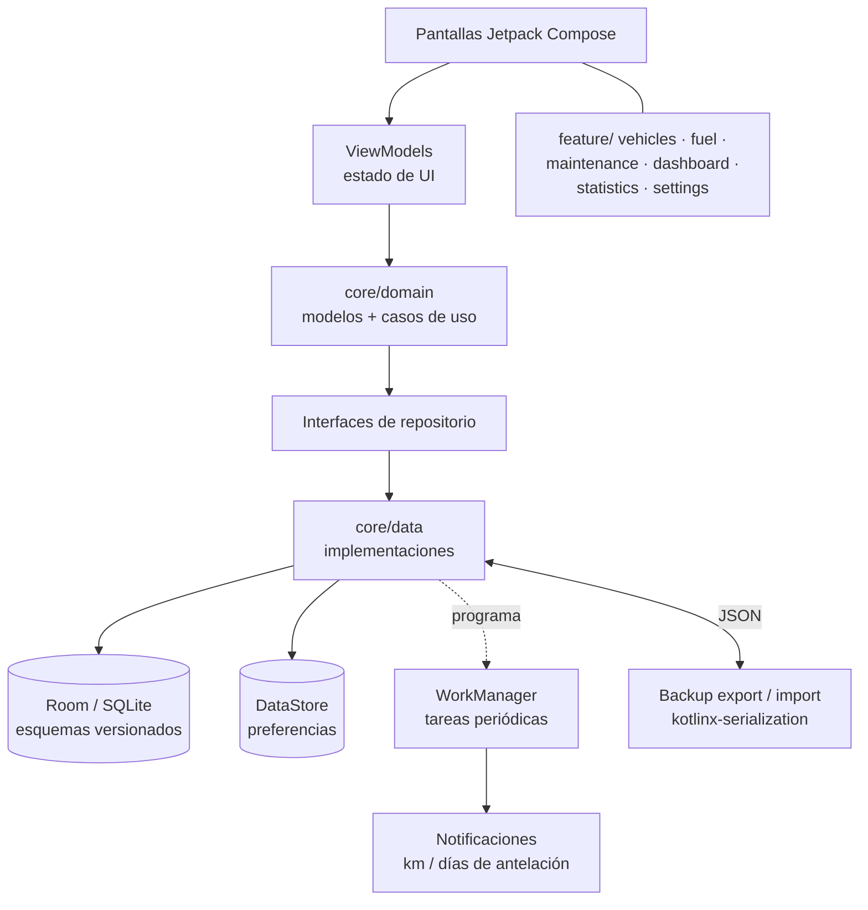
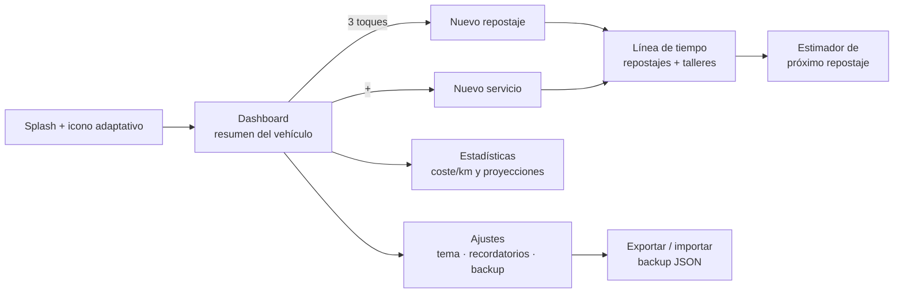

#### 🧠 Visión general del proyecto

Objetivo: responder las preguntas que de verdad se le hacen a un
vehículo — *¿cuánto llevo gastado en combustible?, ¿cuánto me está
costando cada kilómetro?, ¿cuándo toca el próximo servicio?, ¿cómo
viene mi consumo este mes?* — desde el teléfono, sin crear una
cuenta, sin conexión y sin que nadie más vea los datos.

Arrancó como una herramienta para uso personal: el nombre
("Vehicle Manager") es deliberadamente genérico porque nació para
resolver mi propio registro de repostajes y talleres. Cuando la
idea le gustó a un par de amigos, decidí publicarla: APK
descargable desde una landing propia, repositorio en GitHub con
licencia MIT y un changelog público.

Funcionalidades actuales:

- **Vehículos:** alta y edición de marca, matrícula y
  kilometraje, con lista de vehículos registrados.
- **Combustible:** registro de repostajes con odómetro, precio por
  litro, litros y coste total calculado automáticamente; el nuevo
  odómetro se propaga a todas las vistas del vehículo.
- **Mantenimiento:** historial de servicios de taller con coste y
  kilometraje por vehículo, en una **línea de tiempo única** que
  mezcla repostajes y servicios en orden cronológico.
- **Dashboard y estadísticas:** resúmenes mensuales, trimestrales,
  semestrales y anuales, coste por kilómetro, desglose mensual,
  motor de predicción de consumo y estimador del próximo
  repostaje.
- **Recordatorios:** alertas por kilómetros o días de antelación
  (repostaje, presión de neumáticos, servicios), con preferencias
  de hora y vibración.
- **Ajustes:** tema claro / oscuro / automático, exportación e
  importación de backup en JSON y estado visible de los permisos
  de notificación.

#### 🏗️ Arquitectura: Clean Architecture en dos paquetes

La app sigue una Clean Architecture con separación por capas, en
`com.example.vehiclemanager` dividido en `core/` (todo lo
transversal) y `feature/` (una carpeta por pantalla con su lógica).

Las tres viven en su propia capa:

- **UI** — pantallas Compose con ViewModels que exponen el estado
  de la UI; nada de acceso a datos directo desde los composites.
- **Dominio** (`core/domain/`) — modelos, interfaces de
  repositorio y casos de uso. Es la única capa que conocen las
  features.
- **Datos** (`core/data/`) — entidades y DAOs de Room, la clase
  `VehicleDatabase`, preferencias en DataStore y las
  implementaciones de repositorio.

#### 🧰 Tecnologías utilizadas

- **Kotlin** como único lenguaje, con **Jetpack Compose** y
  **Material 3** para la UI declarativa.
- **Clean Architecture** en `core/` (domain / data / ui) +
  `feature/` (vehicles, fuel, maintenance, settings, dashboard,
  statistics).
- **Room** (SQLite local) como base de datos, **DataStore** para
  las preferencias e **Hilt** para la inyección de dependencias.
- **WorkManager** para los recordatorios que deben sobrevivir a
  un reinicio del dispositivo, **Coroutines & Flow** como modelo
  de concurrencia y **kotlinx-serialization** para el backup
  JSON.
- **Tests** con JUnit y Robolectric sobre los DAOs en JVM, más
  tests instrumentados en dispositivo.
- **Gradle Kotlin DSL** con version catalog
  (`gradle/libs.versions.toml`) y un **CHANGELOG.md** público
  bajo SemVer.

🌐 Landing (`vehicle-manager-landing`)

- Sitio de descarga con propuesta de valor, cuatro
  características, sección de privacidad, screenshots
  (`/screens/*.webp`), FAQ y bloque de descarga del APK.
- Desplegada en **Vercel** en
  <https://vehicle-manager-landing.vercel.app/>, con el APK
  (≈ 4 MB) enlazado directamente y el repositorio de la app
  vinculado como "Ver en GitHub".

#### 📦 Infraestructura y despliegue

- **Distribución directa:** APK de release descargable desde la
  landing — sin Play Store por ahora, con "próximamente en Google
  Play" anunciado en la propia página.
- **Requisitos declarados al usuario:** Android 8.0 (API 26) en
  adelante, ≈ 4 MB de instalación, versión actual 0.3.0.
- **Landing en Vercel:** sitio estático que centraliza el pitch,
  la prueba social de privacidad, los screenshots y los enlaces
  de descarga/repositorio.
- **Transparencia:** changelog público en la raíz del
  repositorio y licencia MIT en el código.
- **Sin backend:** no hay servidor, base de datos en la nube,
  API keys ni servicios de terceros que monitorear — el "deploy"
  de la app es un archivo APK.

#### 🌐 Navegación de usuario y flujos

🧭 Flujo de registro: abrir la app → elegir el vehículo →
rellenar odómetro, litros y precio → el coste total y el L/100km
se calculan solos → guardar → el odómetro nuevo actualiza
dashboard, estadísticas y línea de tiempo de una vez.

#### 🔐 Decisiones técnicas clave

✅ 1. Privacidad por diseño: cero cuentas, cero servidores

La alternativa obvia era un backend con login sincronizando
vehículos entre dispositivos. La descarté: los datos de
combustible y gastos de una persona son datos sensibles y el 90%
de los casos de uso ocurren en un solo teléfono. Con Room/SQLite
local, sin registro y sin telemetría, la app funciona idéntica en
avión y en wifi, y "¿qué pasa con tus datos?" tiene una respuesta
de una línea: *no salen de tu teléfono*.

✅ 2. `core/` + `feature/` en lugar de un paquete por capa

Organizar por capas globales (`ui/`, `domain/`, `data/` en la
raíz) hace que añadir una pantalla toque tres carpetas distintas
y que las features se filtren entre sí. El paquete mixto mantiene
cada funcionalidad encapsulada — el módulo `fuel/` no sabe que
existe `statistics/` — dejando en `core/` sólo lo que realmente
es transversal.

✅ 3. WorkManager para recordatorios, no alarma manual

La primera versión programaba alarmas directo con
`AlarmManager`, y al reiniciar el teléfono se perdían. Los
recordatorios (km o días por delante) son trabajo periódico
reprogramable: WorkManager con `hilt-work` los sobrevive a
reinicio, los reprograma automáticamente y deja el estado de
permisos de notificación visible en Ajustes en lugar de fallar
en silencio.

✅ 4. Esquemas de Room versionados y exportados

`app/schemas` guarda el JSON de cada versión del esquema (ya van
cinco), lo que convierte cada migración en un artefacto revisable
y testeable con `room-testing` en lugar de un "confía en mí" que
explota en los usuarios que actualizan desde la Play Store.

✅ 5. Backup JSON portátil como única forma de mover datos

Sin nube y sin cuenta, el backup exportable/importable es la
única vía de migración entre teléfonos. Elegir JSON simple
(`kotlinx-serialization`) sobre un formato binario propio hace
que el archivo sea legible, versionable y rescatable incluso si
la app desaparece mañana.

#### 📈 Resultado actual

✔️ Versión **0.3.0** publicada (2026-03-07) con changelog
SemVer: permisos de notificación visibles en Ajustes, ajustes
guardados explícitamente, estadísticas con unidades corregidas y
recordatorios fiables tras reinicio.

✔️ App **100% offline, sin registro, sin anuncios y sin
compras**, con APK de ≈ 4 MB para Android 8.0+.

✔️ Tests de base de datos pasando — DAOs de repostajes,
mantenimiento y programación verificados con Robolectric en JVM
más los instrumentados en dispositivo.

✔️ Landing publicada en Vercel con screenshots, FAQ y política de
privacidad, sirviendo la descarga del APK.

✔️ Repositorio abierto bajo licencia MIT, listo para recibir
issues y PRs de los amigos que probaron la idea.

#### 📎 Conclusión

Vehicle Manager demuestra que una app de "uso personal" no
necesita volverse un producto con backend para ser útil para
otras personas: una Clean Architecture con `core/` y `feature/`,
Room como única fuente de verdad, WorkManager para lo que debe
sobrevivir reinicios y una landing estática en Vercel para
distribuir el APK son suficientes para publicar algo que la gente
instala y sigue usando.

Las decisiones — cero cuentas, cero servidores, esquemas de Room
versionados, backup en JSON legible — nacieron de la regla simple
de que *los datos de tu vehículo son tuyos y deberían caber en tu
teléfono sin pedirle permiso a nadie*.

¿Querés leer el código fuente o probarla en tu propio coche?

- 🔗 [Landing y descarga APK](https://vehicle-manager-landing.vercel.app/)
- 🔗 [Repositorio de la app Android](https://github.com/alkiory/vehicle-manager-app)

##### 🧠 ¿Te interesa un stack similar?

Si estás montando tu propia app Android offline-first con Kotlin,
Compose y Clean Architecture, o quieres charlar sobre el trade-off
entre "sin backend" y sincronización multi-dispositivo, escribime
sin compromiso 🚀
